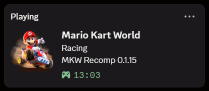

# mkw-recomp-discord

[](https://github.com/Meti0X7CB/mkw-recomp-discord/releases/latest)
[](LICENSE)


Discord Rich Presence for [MKW Recomp](https://github.com/adriadam10/mkw-recomp), the PC port of Mario Kart World.

MKW Recomp doesn't set a Discord status itself. This small PowerShell script starts the game and shows what you're doing on your Discord profile. The status clears when you close the game.

<p align="center"></p>

<p align="center"><sub>How it looks on your own profile. Other people also see a <b>MKW Recomp on GitHub</b> button under it.</sub></p>

- **What you're doing:** *Starting up*, *In the menus* or *Racing*, read from the game's log.
- **Elapsed time** since the game started.
- **Credit to the port:** the version line and the icon link to the MKW Recomp repo. A button opens it too; other people see the button, but Discord hides it on your own view of your profile.
- **Nothing to install** apart from PowerShell 7. The script talks to the Discord desktop app directly through its local pipe, so there are no DLLs or Discord SDK, and the game files aren't modified.

## Requirements

- Windows with the Discord desktop app running.
- [PowerShell 7](https://learn.microsoft.com/powershell/scripting/install/installing-powershell-on-windows): `winget install Microsoft.PowerShell`
- A working MKW Recomp install.

## Setup

1. Download `mkw-recomp-discord.zip` from the [latest release](https://github.com/Meti0X7CB/mkw-recomp-discord/releases/latest) and extract it **inside your MKW Recomp folder**, the one with `mkw.exe`:
   ```
   MKW Recomp\
     mkw.exe
     mkw-recomp-discord\
       mkw-discord.ps1
       config.ini
       install.ps1
   ```
   If you keep it somewhere else, set `game_exe` in `config.ini` to the full path of `mkw.exe`.
2. Right-click `install.ps1` → **Run with PowerShell**. Or from a terminal:
   ```powershell
   pwsh -ExecutionPolicy Bypass -File .\install.ps1 -Desktop -StartMenu
   ```
   It checks that it can find the game and Discord, then creates a **Mario Kart World (Discord)** shortcut. `-Desktop` and `-StartMenu` add copies there.
3. Play using that shortcut instead of `mkw.exe`.

### Steam

If you added MKW Recomp to Steam as a non-Steam game, the installer prints the **Target**, **Start In** and **Launch Options** to paste into the game's Properties. After that, Play in Steam starts the game with the Discord status. Your Steam artwork and playtime aren't affected.

## Configuration

Everything is in `config.ini`:

| Setting | What it does |
| --- | --- |
| `client_id` | Discord application to show the status as. The default one is named "Mario Kart World" and has icon art. Use your own [Discord application](https://discord.com/developers/applications) ID for a different name or art. |
| `game_exe` | Full path to `mkw.exe`. Blank finds it next to the script or one folder up. |
| `game_log` | Full path to the game's `mkw.log`. Blank reads the game data folder from the launcher's `mkw.ini`. |
| `large_image` | Key of the Rich Presence art asset on the Discord application. |
| `project_name`, `project_url`, `button_label` | The credit line, its link and the button. Leave `project_url` blank to remove the links and button. |

## Troubleshooting

- **Nothing on my profile.** Run `pwsh -File .\mkw-discord.ps1 -Test`: it shows where it found the game and log, and whether Discord accepted the connection. In Discord, **Settings → Activity Privacy → Share your detected activities with others** must be on.
- **The game shows up twice.** Discord may also auto-detect `mkw.exe`. Remove it under Discord **Settings → Registered Games**.
- **The status stays on "Starting up".** The script can't find the game's log. Set `game_log` in `config.ini`.
- **Logs:** each run writes what it did to `mkw-discord.log` next to the script.

Run the script with `-NoLaunch` to only attach to a game that's already running.

## Credits

The game port is [MKW Recomp](https://github.com/adriadam10/mkw-recomp) by adriadam10. This project only adds the Discord status and isn't affiliated with MKW Recomp, Nintendo or Discord.

## License

[MIT](LICENSE)
